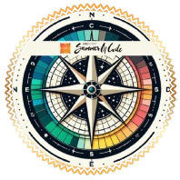
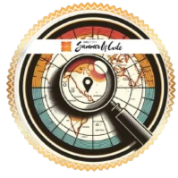
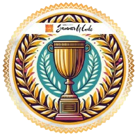
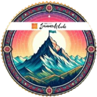
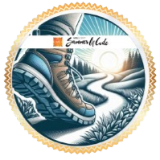

**.NET Core · Angular · SQL · Java**

Open Source Contributor & Mentor · GSSoC'24 · MCA Graduate

 

## 🌸 スタック &nbsp;·&nbsp; Stack

 

&nbsp;

&nbsp;

&nbsp;

&nbsp;

&nbsp;

&nbsp;

&nbsp;

  

<i>初心忘るべからず</i> &nbsp;·&nbsp; Never forget your beginner's mind.

## 🏯 ストア &nbsp;·&nbsp; Dev Store

<i>千里の道も一歩から</i> &nbsp;·&nbsp; A journey of a thousand miles begins with a single step.

## ⛩️ オープンソース &nbsp;·&nbsp; Open Source

**GirlScript Summer of Code 2024 Extended**
 
Ranked **656th** of 28,000+ participants · 8 PRs merged · 6 badges · score 585

 

<table>
  <tr align="center">
    <td width="140">
       
      <b>Explorer</b>
    </td>
    <td width="140">
       
      <b>Adventurer</b>
    </td>
    <td width="140">
       
      <b>Champion</b>
    </td>
  </tr>
  <tr align="center">
    <td width="140">
       
      <b>Summit Seeker</b>
    </td>
    <td width="140">
       
      <b>Trailblazer</b>
    </td>
    <td width="140">
       
      <b>API Student Expert</b> 
      Postman
    </td>
  </tr>
</table>

 

<i>猿も木から落ちる</i> &nbsp;·&nbsp; Even experts make mistakes. Keep building.

Ask me about .NET, Angular and backend development

